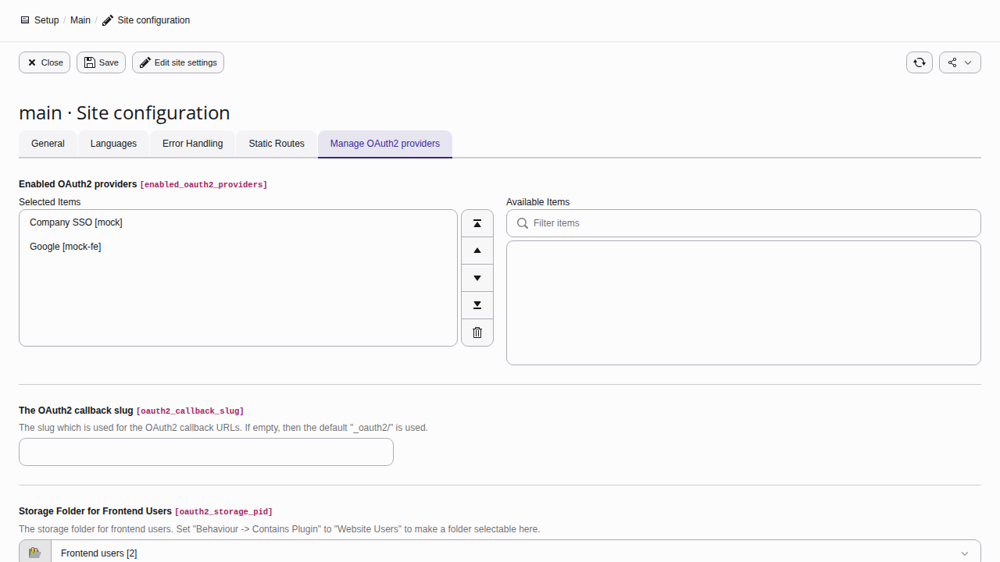

.. include:: ../Includes.txt

.. _configuration:

=============
Configuration
=============

The providers are configured in PHP, in
:php:`$GLOBALS['TYPO3_CONF_VARS']['EXTENSIONS']['oauth2_client']`. Put the
configuration in :file:`config/system/additional.php` (Composer) or
:file:`typo3conf/system/additional.php` (classic mode), so secrets can come
from environment variables.

.. contents::
   :local:
   :depth: 1

.. _configuration-example:

Complete example
================

One provider for backend and frontend, using the bundled ``GenericProvider``
with an OpenID Connect provider (here: authentik):

.. code-block:: php
   :caption: config/system/additional.php

   use Waldhacker\Oauth2Client\Service\Oauth2ProviderManager;

   // Third-party providers redirect back to TYPO3 cross-site: the OAuth2
   // session cookie must be sent on that redirect (TYPO3 default for BE is "strict")
   $GLOBALS['TYPO3_CONF_VARS']['BE']['cookieSameSite'] = 'lax';

   $GLOBALS['TYPO3_CONF_VARS']['EXTENSIONS']['oauth2_client']['providers'] = [
       'authentik' => [
           'label' => 'Company SSO',
           'description' => 'Log in with your company account',
           'iconIdentifier' => 'actions-key',
           'scopes' => [
               Oauth2ProviderManager::SCOPE_BACKEND,
               Oauth2ProviderManager::SCOPE_FRONTEND,
           ],
           'options' => [
               'clientId' => getenv('AUTHENTIK_CLIENT_ID'),
               'clientSecret' => getenv('AUTHENTIK_CLIENT_SECRET'),
               'urlAuthorize' => 'https://auth.example.com/application/o/authorize/',
               'urlAccessToken' => 'https://auth.example.com/application/o/token/',
               'urlResourceOwnerDetails' => 'https://auth.example.com/application/o/userinfo/',
               'responseResourceOwnerId' => 'sub',
               'scopes' => ['openid', 'email', 'profile'],
               'scopeSeparator' => ' ',
           ],
       ],
   ];

The array key (``authentik``) is the *provider identifier*. It is part of the
redirect URIs and of every stored identity: do not change it once users have
linked their accounts.

.. _configuration-provider-options:

Provider options
================

:php:`$GLOBALS['TYPO3_CONF_VARS']['EXTENSIONS']['oauth2_client']['providers'][<identifier>]`

.. confval:: label
   :name: provider-label
   :type: string
   :required: true

   Button label on the login screens and in the "Manage providers" views.
   An ``LLL:`` reference is translated.

.. confval:: description
   :name: provider-description
   :type: string
   :Default: ``''``

   Shown in the "Manage providers" views. An ``LLL:`` reference is translated.

.. confval:: iconIdentifier
   :name: provider-iconidentifier
   :type: string
   :Default: ``'actions-key'``

   A registered icon identifier. Register own icons in
   :file:`Configuration/Icons.php` of your site package.

.. confval:: implementationClassName
   :name: provider-implementationclassname
   :type: class-string
   :Default: ``\League\OAuth2\Client\Provider\GenericProvider::class``

   Provider class of league/oauth2-client. Composer installations can use a
   provider package, for example ``\League\OAuth2\Client\Provider\Github::class``
   from ``league/oauth2-github``. Classic mode ships the ``GenericProvider``
   only.

.. confval:: scopes
   :name: provider-scopes
   :type: array
   :Default: backend and frontend

   Where the provider is offered:
   :php:`Oauth2ProviderManager::SCOPE_BACKEND` (``'backend'``) and/or
   :php:`Oauth2ProviderManager::SCOPE_FRONTEND` (``'frontend'``). Not to be
   confused with the OAuth2 scopes in :confval:`options.scopes <provider-options-scopes>`.

.. confval:: options
   :name: provider-options
   :type: array
   :required: true

   Passed to the constructor of the provider class. The extension sets
   ``redirectUri`` itself. The keys below are the ones of the
   ``GenericProvider``; provider packages document their own.

.. confval:: options.clientId
   :name: provider-options-clientid
   :type: string
   :required: true

   Client ID of the application registered at the provider.

.. confval:: options.clientSecret
   :name: provider-options-clientsecret
   :type: string
   :required: true

   Client secret of the application registered at the provider.

.. confval:: options.urlAuthorize
   :name: provider-options-urlauthorize
   :type: string
   :required: true

   Authorization endpoint.

.. confval:: options.urlAccessToken
   :name: provider-options-urlaccesstoken
   :type: string
   :required: true

   Token endpoint.

.. confval:: options.urlResourceOwnerDetails
   :name: provider-options-urlresourceownerdetails
   :type: string
   :required: true

   Endpoint that returns the user (OpenID Connect: the user info endpoint).

.. confval:: options.responseResourceOwnerId
   :name: provider-options-responseresourceownerid
   :type: string
   :Default: ``'id'``

   Field of the user info response that identifies the user. OpenID Connect
   providers return ``sub``.

.. confval:: options.scopes
   :name: provider-options-scopes
   :type: array
   :Default: none

   OAuth2 scopes to request, for OpenID Connect ``['openid', 'email', 'profile']``.

.. confval:: options.scopeSeparator
   :name: provider-options-scopeseparator
   :type: string
   :Default: ``','``

   Separator for the requested scopes. OpenID Connect providers expect ``' '``.

.. confval:: options.proxy
   :name: provider-options-proxy
   :type: string

   Proxy for the HTTP requests to the provider, for example ``'127.0.0.1:8080'``.
   With a proxy, ``options.verify => false`` turns off TLS verification
   (debugging only). See the `league/oauth2-client documentation
   <https://oauth2-client.thephpleague.com/usage/#using-a-proxy>`__.

.. confval:: collaborators
   :name: provider-collaborators
   :type: array

   Replaces collaborators of the provider, for example ``'httpClient'``. A
   string value is instantiated with :php:`GeneralUtility::makeInstance()`.

The ``GenericProvider`` also accepts ``accessTokenMethod``,
``accessTokenResourceOwnerId``, ``responseError`` and ``responseCode``.

.. _configuration-redirect-uris:

Redirect URIs
=============

The provider only redirects back to URIs you registered for the client.
TYPO3 uses four of them. Replace ``<identifier>`` with the provider identifier.

Backend login
   ``https://example.com/typo3/login?loginProvider=1616569531&oauth2-provider=<identifier>&login_status=login&commandLI=attempt``

Backend linking (user settings)
   ``https://example.com/typo3/oauth2/callback/handle?oauth2-provider=<identifier>&action=callback``

Frontend login
   ``https://example.com/_oauth2?oauth2-provider=<identifier>&logintype=login``

Frontend linking (plugin)
   ``https://example.com/_oauth2?oauth2-provider=<identifier>&tx_oauth2client%5Baction%5D=verify``

Where the URIs differ per installation:

*  The backend URIs use the host the backend is called with and its entry
   point (``/typo3``).
*  The frontend URIs use the base of the current **site language** and its
   :ref:`callback slug <configuration-frontend>` (default ``_oauth2``). A site
   with ``/de/`` as German base needs ``https://example.com/de/_oauth2?…`` as
   well. Register the frontend URIs for every site and language that offers
   the provider.
*  Some providers compare the full URI including the query string, others
   only scheme, host and path. Registering the full URIs works with both.

.. _configuration-backend:

Backend
=======

Cookies
   TYPO3 stores the OAuth2 state in a session cookie that follows
   ``cookieSameSite`` of the backend. With the default ``strict``, the browser
   does not send it on the redirect from a provider on another site and the
   login fails. Set it to ``lax``:
   :php:`$GLOBALS['TYPO3_CONF_VARS']['BE']['cookieSameSite'] = 'lax';`
   (the frontend default is ``lax`` already).

Access rights
   Non-admin users need access to the module :guilabel:`User Settings`
   (``user_setup``) to link providers.

Hiding the setting
   User TSconfig can hide the "Manage OAuth2 providers" button:

   .. code-block:: typoscript

      # TYPO3 14.3
      setup.fields.oauth2_providers.disabled = 1
      # TYPO3 13.4
      setup.fields.tx_oauth2_client_configs.disabled = 1

Revoking links
   Administrators see the linked providers of a user in the backend user and
   frontend user records (field :guilabel:`OAuth2 Client Configuration`) and
   can deactivate them there. Non-admins need modify rights on
   ``tx_oauth2_feuser_provider_configuration`` to do this for frontend users.

.. _configuration-frontend:

Frontend
========

Site configuration
------------------

Each site enables its providers in the site configuration
(:guilabel:`Sites` > :guilabel:`Setup` on 14.3, :guilabel:`Site Management` >
:guilabel:`Sites` on 13.4), tab :guilabel:`Manage OAuth2 providers`. Each
site language has the same fields to override the site values.

   Frontend settings of a site

Enabled OAuth2 providers (``enabled_oauth2_providers``)
   Providers with the ``frontend`` scope that this site offers, in this order.

The OAuth2 callback slug (``oauth2_callback_slug``)
   Path of the frontend redirect URIs, default ``_oauth2``. It must not be the
   slug of a page.

Storage Folder for Frontend Users (``oauth2_storage_pid``)
   **Required.** Only frontend users in this folder (not in subfolders) can
   log in or link a provider. Without it, a frontend OAuth2 login throws an
   exception. The list shows folders with :guilabel:`Contains Plugin` set to
   :guilabel:`Website Users`.

The same settings in :file:`config/sites/<site>/config.yaml`:

.. code-block:: yaml

   enabled_oauth2_providers: 'authentik,google'
   oauth2_callback_slug: '_oauth2'
   oauth2_storage_pid: 12
   languages:
     -
       languageId: 1
       base: /de/
       enabled_oauth2_providers: authentik

Login form
----------

felogin gets the variable ``{oauth2Providers}`` with the providers enabled for
the current site language. Add a second form to your felogin template
(:file:`Login/Login.fluid.html` on 14.3, :file:`Login/Login.html` on 13.4),
next to the username/password form. A separate form avoids the ``required``
attributes of the username and password fields:

.. code-block:: html

   <html xmlns:f="http://typo3.org/ns/TYPO3/CMS/Fluid/ViewHelpers"
         xmlns:core="http://typo3.org/ns/TYPO3/CMS/Core/ViewHelpers"
         data-namespace-typo3-fluid="true">

   <f:if condition="{oauth2Providers}">
       <f:form target="_top" fieldNamePrefix="" action="login">
           <f:form.hidden name="logintype" value="login"/>
           <f:for each="{oauth2Providers}" as="provider">
               <button type="submit" name="oauth2-provider" value="{provider.identifier}">
                   <core:icon identifier="{provider.iconIdentifier}"/> {provider.label}
               </button>
           </f:for>
       </f:form>
   </f:if>

felogin is not required. A link to any page that allows logins starts a login
as well: ``https://example.com/login?logintype=login&oauth2-provider=<identifier>``.
After the login, TYPO3 returns to that page.

Redirect after login
--------------------

To return to another page of the same site, add
``after-oauth2-redirect-uri=<absolute URL>`` to the login or linking link. This
is off by default, enable it with a feature flag:

.. code-block:: php

   $GLOBALS['TYPO3_CONF_VARS']['SYS']['features']['oauth2.frontend.login.afterOauth2RedirectUriFromQuery'] = true;

The URL must use the scheme and host of the current site language. Do not add
the parameter to the registered redirect URIs.

"Manage OAuth2 providers" plugin
--------------------------------

Add the content element :guilabel:`Manage OAuth2 providers`
(``oauth2client_manageproviders``) to a page for logged-in users, for example
the profile page. It lists the providers enabled for the site; users activate
and deactivate them there.

.. _configuration-templates:

Templates
=========

Frontend plugin
   Override the templates with TypoScript and copy
   :file:`Resources/Private/Templates/Frontend/ManageProviders/List.html` and
   :file:`Resources/Private/Partials/Frontend/ManageProviders/ProviderItem.html`:

   .. code-block:: typoscript

      plugin.tx_oauth2client.view {
          templateRootPaths.100 = EXT:site_package/Resources/Private/Templates/
          partialRootPaths.100 = EXT:site_package/Resources/Private/Partials/
      }

Backend login
   Add template paths for :file:`Resources/Private/Templates/Backend/Oauth2LoginProvider.html`:

   .. code-block:: php

      $GLOBALS['TYPO3_CONF_VARS']['EXTENSIONS']['oauth2_client']['view'] = [
          'templateRootPaths' => ['EXT:site_package/Resources/Private/Templates/Backend/'],
          'partialRootPaths' => ['EXT:site_package/Resources/Private/Partials/Backend/'],
          'layoutRootPaths' => ['EXT:site_package/Resources/Private/Layouts/Backend/'],
          // optional, default "Oauth2LoginProvider"
          'template' => 'Oauth2LoginProvider',
      ];

.. _configuration-providers:

Provider examples
=================

.. toctree::
   :maxdepth: 1
   :titlesonly:

   Authentik
   EntraId
   Keycloak
   Gitlab
   Github
   Google
   Hydra
