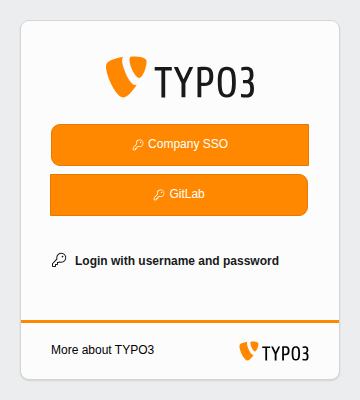
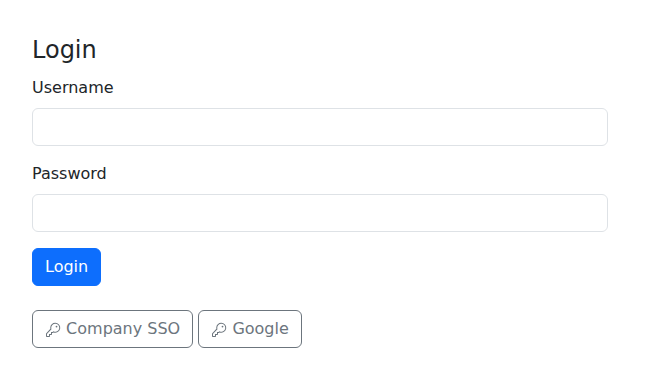

.. include:: Includes.txt

.. _start:

================================================
TYPO3 OAuth2 login client (backend and frontend)
================================================

:Extension key:
   oauth2_client

:Package name:
   co-stack/typo3-oauth2-client

:Version:
   |release|

:Language:
   en

:Authors:
   Maik Schneider, XIMA Media GmbH

:Email:
   maik.schneider@xima.de

:License:
   This extension documentation is published under the
   `CC BY-NC-SA 4.0 <https://creativecommons.org/licenses/by-nc-sa/4.0/>`__ (Creative Commons)
   license

----

Backend and frontend users log in to TYPO3 with an OAuth2 / OpenID Connect
provider such as authentik, Microsoft Entra ID, Keycloak, GitLab, GitHub or Google.
Each user links the provider account to their existing TYPO3 account once and
can then log in with it.

   Backend login with two configured providers

   Frontend login (felogin) with two configured providers

.. toctree::
   :maxdepth: 2
   :titlesonly:

   Introduction/Index
   Installation/Index
   Configuration/Index
   UserGuide/Index
   Upgrade/Index
   Developers/Index
   Changelog
   Sitemap
