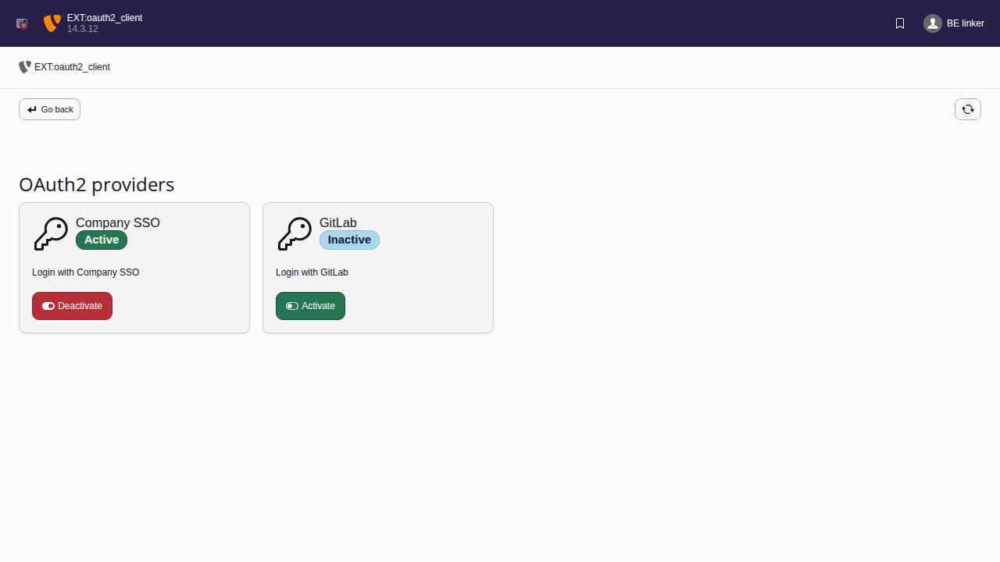
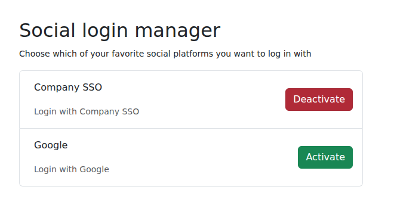

.. include:: ../Includes.txt

.. _introduction:

============
Introduction
============

.. _what-it-does:

What does it do?
================

The extension adds OAuth2 / OpenID Connect logins to TYPO3:

*  **Backend login:** the TYPO3 login screen gets a "Login with OAuth2
   providers" option with one button per configured provider.
*  **Frontend login:** felogin (or any link) starts a login with a provider.
*  **Users link their own accounts:** backend users link a provider in their
   user settings, frontend users in the "Manage OAuth2 providers" plugin.
   A user can link several providers and unlink them again.
*  **Per-site frontend setup:** each site (or site language) chooses its
   providers, its frontend user storage folder and its callback slug.
*  **Any OAuth2 provider:** the extension builds on
   `league/oauth2-client <https://oauth2-client.thephpleague.com>`__. Its
   ``GenericProvider`` works with every provider that has an authorization,
   a token and a user info endpoint. With Composer you can also use a provider
   package, for example ``league/oauth2-github``.
*  **Backend MFA stays in place:** after an OAuth2 backend login, TYPO3 still
   asks for the multi-factor authentication of the user.

.. _how-linking-works:

How linking works
=================

The extension never creates or changes TYPO3 users. It stores an *identity*:
the provider identifier plus the user ID the provider returns. At login, it
looks up the TYPO3 user that owns this identity.

#. An administrator configures the providers.
#. A user logs in once with username and password.
#. Backend users open :guilabel:`User Settings` > :guilabel:`Account security`
   > :guilabel:`Manage OAuth2 providers` and click :guilabel:`Activate`.
   Frontend users click :guilabel:`Activate` in the "Manage OAuth2 providers"
   plugin.
#. The user signs in at the provider. TYPO3 stores the identity.
#. From now on the user can log in with the provider.

   A backend user manages the linked providers.

   A frontend user manages the linked providers.

.. _what-it-does-not-do:

What it does not do
===================

*  **No user provisioning.** Users without a TYPO3 account, or without a linked
   identity, cannot log in. To create or update users from provider data
   (including group mapping), use the add-on
   `xima/xima-oauth2-extended <https://github.com/xima-media/xima-oauth2-extended>`__
   or write your own listener for the :ref:`lookup events <developer-events>`.
*  **No ID token validation.** The user is read from the user info endpoint of
   the provider (``urlResourceOwnerDetails``).
*  **No PKCE.** Do not set the ``pkceMethod`` option yet: the code verifier is
   not kept between the redirect and the callback.
*  **No single logout.** Logging out of TYPO3 does not log out of the provider.
