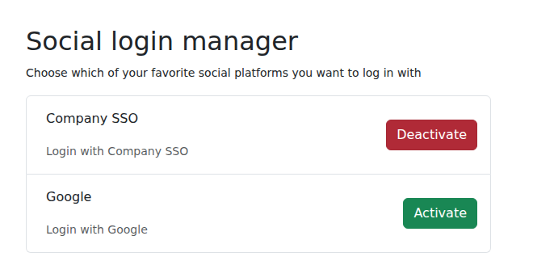
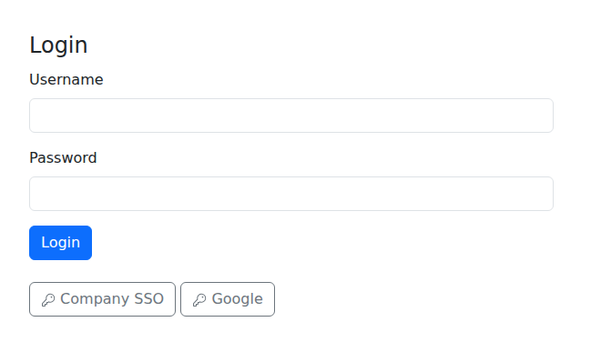

.. include:: ../Includes.txt

.. _user_guide:

==========
User guide
==========

A provider only works after you linked it to your TYPO3 account once. Ask your
administrator which providers are available.

Backend
=======

Link a provider
---------------

.. rst-class:: bignums

1. Open your user settings

   Click your user name in the top bar, then :guilabel:`User Settings`. On the
   :guilabel:`Account security` tab, click :guilabel:`Manage OAuth2 providers`.

   .. figure:: ../Images/Backend/userSettings_setup.png
      :class: with-shadow
      :alt: User settings, tab "Account security", with the button "Manage OAuth2 providers"
      :width: 600px

      The button below the multi-factor authentication settings

2. Activate a provider

   Click :guilabel:`Activate` on the provider you want to use.

   .. figure:: ../Images/Backend/configuredProviders.png
      :class: with-shadow
      :alt: Module "OAuth2 providers" with an active and an inactive provider
      :width: 600px

      Active and inactive providers

3. Sign in at the provider

   A popup opens. Sign in and allow the access. The popup closes and the
   provider shows :guilabel:`Active`.

   If nothing opens, allow popups for the TYPO3 backend.

To unlink a provider, click :guilabel:`Deactivate` and confirm.

Log in with a provider
----------------------

.. rst-class:: bignums

1. Switch the login form

   On the TYPO3 login screen, click
   :guilabel:`Login with OAuth2 providers (Social login)`.

   .. figure:: ../Images/Backend/login_step1.png
      :class: with-shadow
      :alt: TYPO3 backend login form with the link "Login with OAuth2 providers"
      :width: 300px

      The link below the login form

2. Choose the provider

   Click the provider. After signing in there, you are logged in to TYPO3.
   If multi-factor authentication is set up, TYPO3 asks for it next.

   .. figure:: ../Images/Backend/loginScreen.png
      :class: with-shadow
      :alt: TYPO3 backend login screen with one button per provider
      :width: 300px

      One button per provider

TYPO3 remembers the login form you used last time.

Frontend
========

Link a provider
---------------

Log in with your username and password, then open the page with the
"Manage OAuth2 providers" plugin (often your profile page). Click
:guilabel:`Activate` on a provider and sign in there. You return to the same
page. :guilabel:`Deactivate` unlinks the provider.

   The plugin with one linked provider

Log in with a provider
----------------------

On the login page, click the button of a linked provider and sign in there.
You return to the page you started on, logged in.

   The login form of a site with two providers
