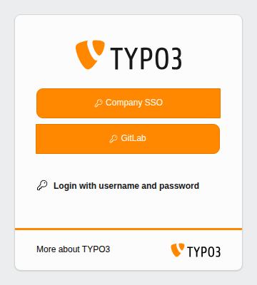
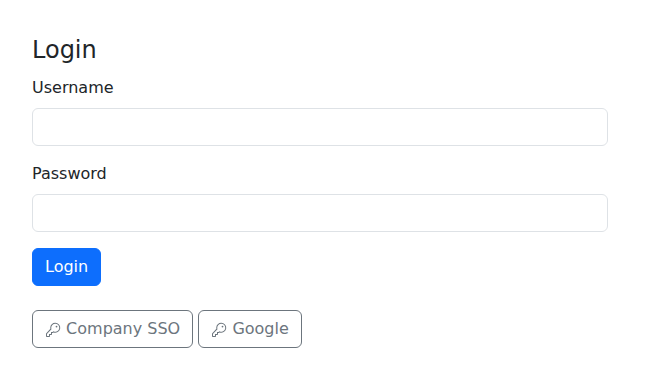
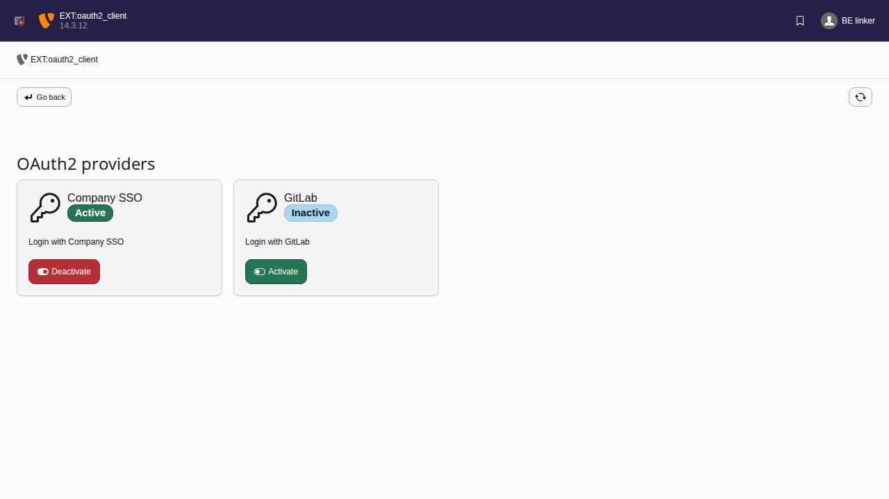
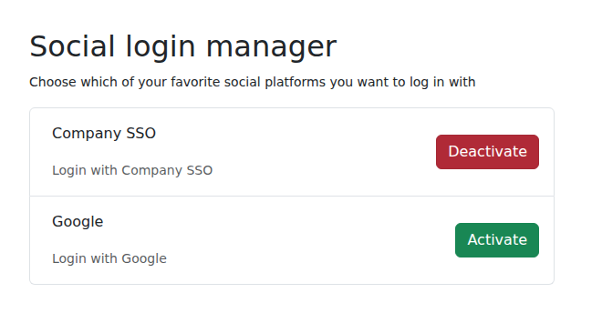

# TYPO3 OAuth2 login client (backend and frontend)

[](https://github.com/xima-media/typo3-oauth2-client/actions/workflows/tests.yml)
[](https://github.com/xima-media/typo3-oauth2-client/actions/workflows/sca.yml)

Backend and frontend users log in to TYPO3 with an OAuth2 / OpenID Connect provider such as authentik, Microsoft Entra ID, Keycloak, GitLab, GitHub or Google. Each user links the provider account to their existing TYPO3 account once (backend: user settings, frontend: plugin) and can then log in with it.

| Backend login | Frontend login |
|---|---|
|  |  |

| Backend: manage providers | Frontend: manage providers plugin |
|---|---|
|  |  |

The extension does not create users. For user provisioning and group mapping, see the add-on [xima/xima-oauth2-extended](https://github.com/xima-media/xima-oauth2-extended).

## Supported versions

| Version | TYPO3      | PHP  | Support               |
|---------|------------|------|-----------------------|
| 5.x     | 13.4, 14.3 | 8.2+ | Features and bugfixes |
| 4.x     | 12.4, 13.4 | 8.1+ | Security fixes only   |

## Installation

```bash
composer require co-stack/typo3-oauth2-client
vendor/bin/typo3 extension:setup -e oauth2_client
```

On TYPO3 13.4, also `composer require typo3/cms-setup` if your project does not have it: backend users link their providers in its user settings.

Without Composer, install `oauth2_client` from the [TER](https://extensions.typo3.org/extension/oauth2_client). The TER package bundles `league/oauth2-client` with its `GenericProvider`.

## Minimal configuration

In `config/system/additional.php`, here for an OpenID Connect provider:

```php
$GLOBALS['TYPO3_CONF_VARS']['BE']['cookieSameSite'] = 'lax';

$GLOBALS['TYPO3_CONF_VARS']['EXTENSIONS']['oauth2_client']['providers']['authentik'] = [
    'label' => 'Company SSO',
    'options' => [
        'clientId' => getenv('AUTHENTIK_CLIENT_ID'),
        'clientSecret' => getenv('AUTHENTIK_CLIENT_SECRET'),
        'urlAuthorize' => 'https://auth.example.com/application/o/authorize/',
        'urlAccessToken' => 'https://auth.example.com/application/o/token/',
        'urlResourceOwnerDetails' => 'https://auth.example.com/application/o/userinfo/',
        'responseResourceOwnerId' => 'sub',
        'scopes' => ['openid', 'email', 'profile'],
        'scopeSeparator' => ' ',
    ],
];
```

Then register the redirect URIs at the provider and, for the frontend, enable the provider and a user storage folder in the site configuration.

## Documentation

- [Introduction](Documentation/Introduction/Index.rst)
- [Installation](Documentation/Installation/Index.rst)
- [Configuration](Documentation/Configuration/Index.rst): all options, redirect URIs, site configuration, felogin template, provider examples ([authentik](Documentation/Configuration/Authentik.rst), [Microsoft Entra ID](Documentation/Configuration/EntraId.rst), [Keycloak](Documentation/Configuration/Keycloak.rst), [GitLab](Documentation/Configuration/Gitlab.rst), [GitHub](Documentation/Configuration/Github.rst), [Google](Documentation/Configuration/Google.rst), [Ory Hydra](Documentation/Configuration/Hydra.rst))
- [User guide](Documentation/UserGuide/Index.rst)
- [Upgrading to 5.0](Documentation/Upgrade/Index.rst)
- [Developer information](Documentation/Developers/Index.rst): events, local development, release
- [Changelog](CHANGELOG.md)

## Contributing

Requirements: DDEV and Docker.

```bash
ddev start
ddev init-typo3                 # fresh TYPO3 14.3 with mock OAuth2 providers and fixtures
ddev composer test:unit
ddev composer test:functional
ddev playwright test            # end-to-end tests against the mock OAuth2 server
ddev composer ci:sca
```

Backend: http://oauth2-client.ddev.site/typo3/ (`admin` / `Passw0rd!`). Details in the [developer information](Documentation/Developers/Index.rst#local-development).

## Credits

Originally developed by Oliver Eglseder and waldhacker.

## Issues & Contributions

Find the code at https://github.com/xima-media/typo3-oauth2-client

Report issues at https://github.com/xima-media/typo3-oauth2-client/issues

### Security

If you learn about a potential security issue, please **do not** create a public visible issue.
Contact the TYPO3 Security Team via security@typo3.org instead.
Please always include the version number where you've discovered the issue.
For more details see [TYPO3 Security Team](https://typo3.org/community/teams/security/).
